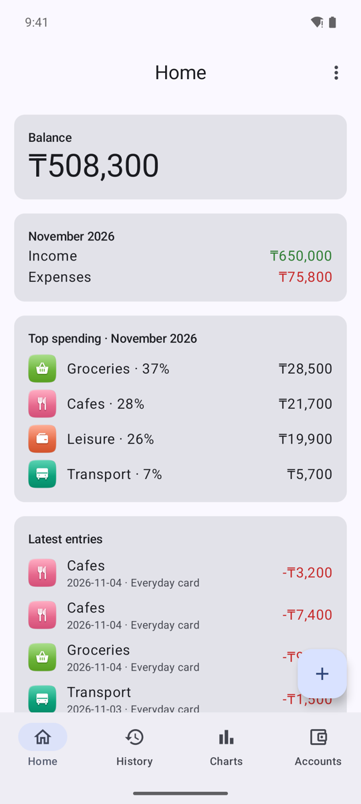
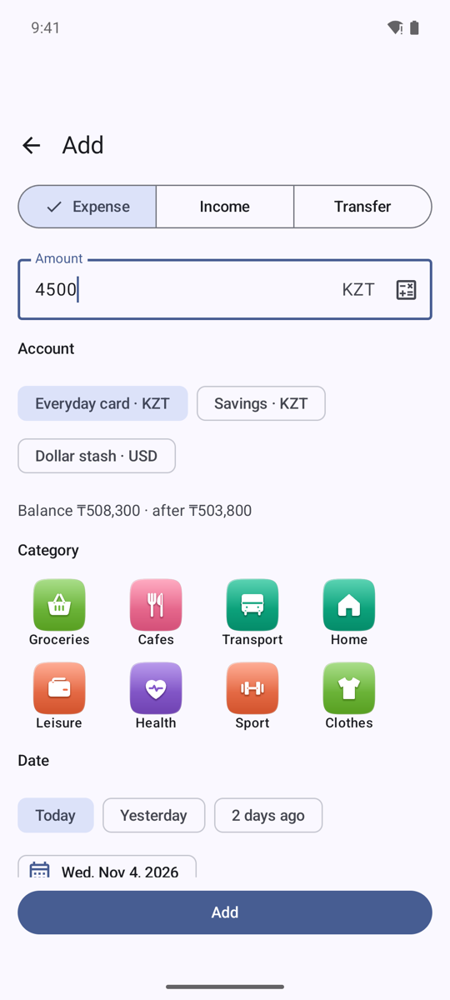
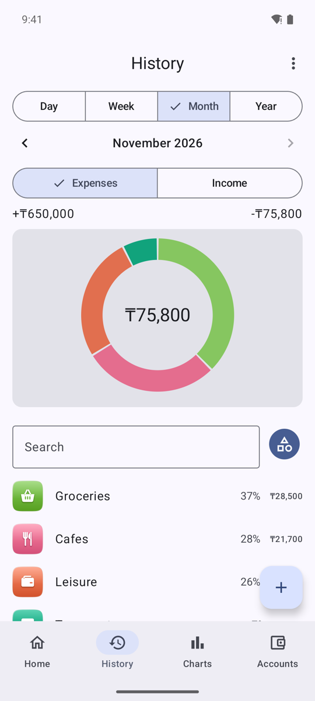
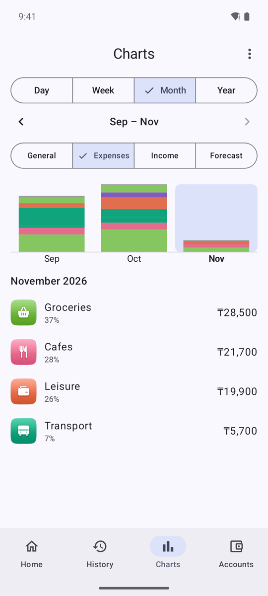
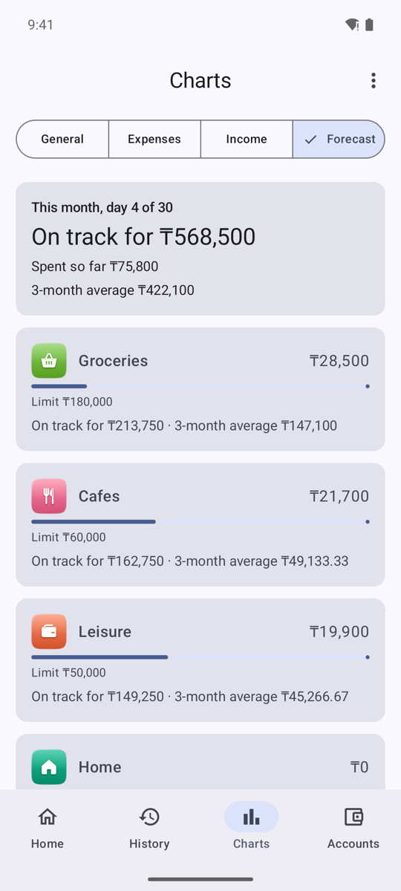
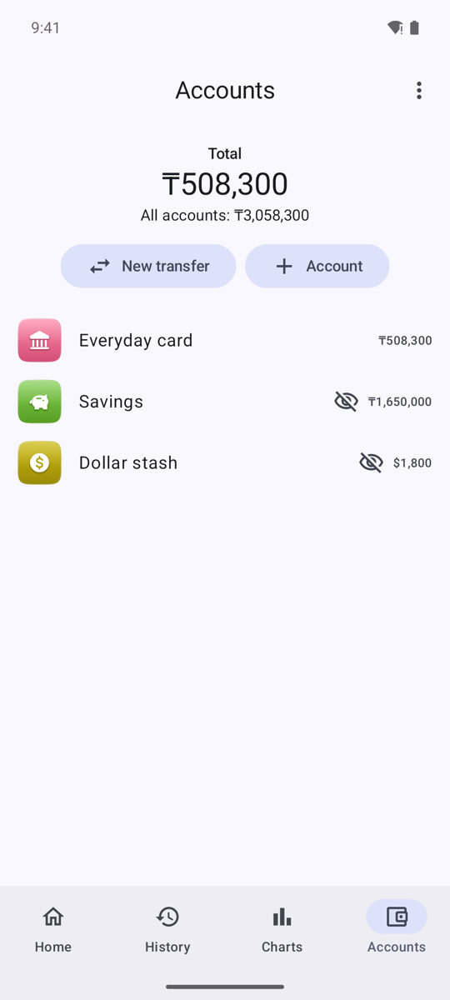
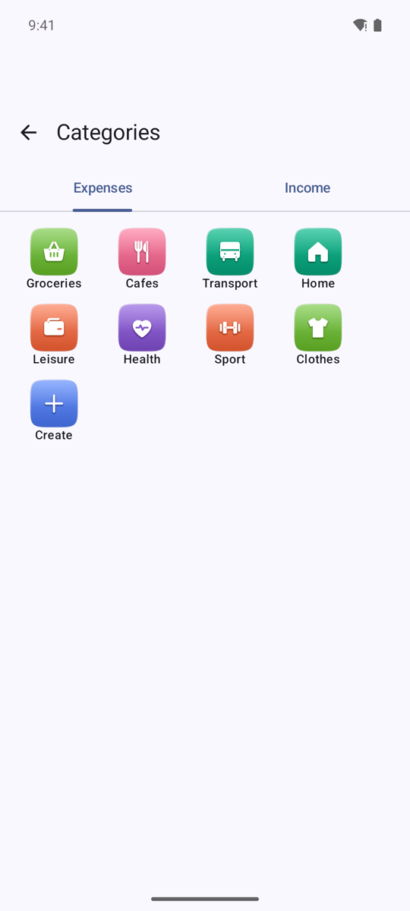
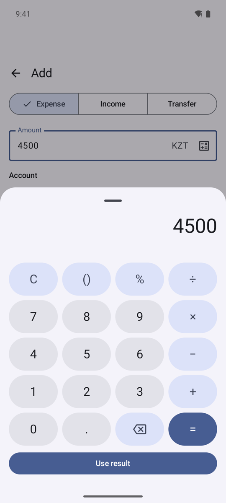
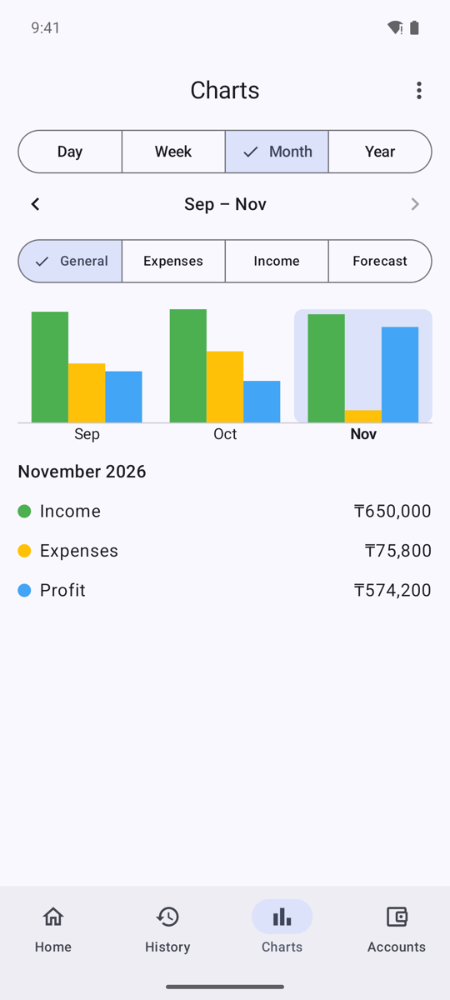
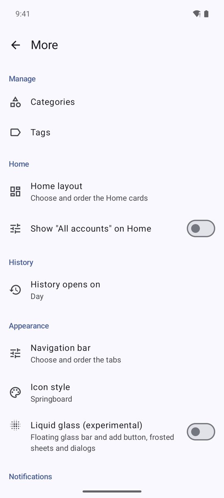

<p align="center"></p>

<h1 align="center">Money Tracker</h1>

<p align="center">
A personal Android expense tracker: fast daily entry, charts, spending forecasts with limit warnings, and a Google Sheets copy of your data that opens on a PC.<br>
No ads, no payments, no analytics, no server.
</p>

<p align="center">





</p>

> All screenshots show **fictional demo data** (see [Demo data](#demo-data)).

Private, single-user app for everyday personal finance, installed by sideloading an APK, not through Google Play.
Your data lives in a local database on the phone; the optional Google Sheet is a copy you can analyse on a computer.

## Features

**Daily entry**
- Expense, income and transfer on one screen; the amount field comes with a built-in calculator (`1000 + 10%` = 1100).
- Pick the account, a category from a grid, a date (today / yesterday / 2 days ago / calendar), tags and a comment. The Add button is pinned above the keyboard.
- Transfers between accounts, including different currencies (for example KZT to USD).
- Balance overwrite: type the real balance of an account and the app books the difference as a "Balance correction".

**Accounts, categories, tags**
- Several accounts and currencies (for example KZT and USD), each with its own icon and color.
- Accounts can be hidden from the headline **Total** (an "All accounts" figure is shown under it) or archived.
- Income and expense categories with original icons, colors, manual order and an optional **planned outlay per month**.
- Tags for cross-cutting labels such as "work" or "weekend".

**History**
- Day / Week / Month / Year slicer with arrows; opens on the day by default (changeable).
- Grouped by category with share bars and a donut; tap a group to see its entries; tap an entry to edit or delete it. Transfers are grouped by account pair.
- Search.

**Charts and forecast**
- General (income / expenses / profit or loss), Expenses and Income stacked by category, by day / week / month / year.
- **Forecast**: projected month-end spending, overall and per category, from the run-rate (spent so far ÷ days elapsed × days in month) with the 3-month average next to it.
- **Limit warnings** on Home and as notifications when a projection exceeds a category's limit (threshold configurable).

**Reminders and notifications**
- Daily reminder at a time you choose (default 20:00): "enter today's spending".
- Spending-warning notifications, one per month, category and level.

**Data and sync**
- One-time import of a `.mmbackup` backup file; re-importing never undoes later phone edits.
- **Google Sheets sync** (pull, then push) by hand or weekly in the background. The app only reaches the sheet it created (`drive.file` scope).
- Updates from GitHub releases inside the app, with release notes.

**Look and feel**
- Material 3 with the system accent color and dark mode, original icon artwork in three styles, customizable bottom bar and Home cards, swipe between tabs, optional experimental "liquid glass" look.

<p align="center">





</p>

## Quick start (user manual)

1. **Install.** Download `money-tracker-vX.Y.Z.apk` from the GitHub release page, open it on the phone and allow installing from this source. Needs Android 16 (API 36). Later versions come from *More → App updates*.
2. **Bring your data (optional).** Put a `.mmbackup` backup file in the phone's Downloads, then *More → Data and sync → Import .mmbackup*. Or just start empty and add accounts and categories yourself.
3. **Add an entry.** Tap **+**, choose Expense / Income / Transfer, type the amount, pick account, category and date, tap **Add**.
4. **Look back.** *History* shows what you spent per day, week, month or year; *Charts* shows trends; *Home* shows the balance and the month.
5. **Set limits.** *More → Categories →* a category *→ Planned outlay per month*. Forecast and warnings start working from that.
6. **Get a reminder.** *More → Daily reminder*, switch on and pick a time. Allow notifications when asked.
7. **Use it on a PC.** *More → Google Sheets*: **Connect Google**, then **Create or refresh the sheet**. After that, **Sync now** or leave the weekly sync on. One-time Google Cloud setup: [docs/GOOGLE_SETUP.md](docs/GOOGLE_SETUP.md).

More detail (screens, tips, FAQ) is in the wiki pages under [docs/wiki](docs/wiki/Home.md).

## Demo data

The screenshots come from a generated, fictional backup, never from real data:

```bash
python tools/make_demo_backup.py data/demo/demo.mmbackup --today 2026-11-04
```

Copy it to the phone or emulator and import it from *More*. `data/` is git-ignored.

## Build from source

JDK 25 (Gradle 9.6 runs on JDK 17..25 only), Android SDK with platforms 36 and 37.

```bash
brew install openjdk@25   # once
export JAVA_HOME=/opt/homebrew/opt/openjdk@25 PATH=/opt/homebrew/opt/openjdk@25/bin:$PATH
./gradlew testDebugUnitTest assembleDebug     # APK: app/build/outputs/apk/debug/app-debug.apk
```

Stack: Kotlin, Jetpack Compose + Material 3, Room, WorkManager, hand-wired DI. Money is stored as `Long` minor units, never `Double`. No analytics and no network calls except Google auth and Sheets/Drive and the update check against GitHub.

## Documentation

| Doc | What it covers |
|---|---|
| [docs/wiki](docs/wiki/Home.md) | User guide: screens, entering data, charts and forecast, Sheets sync, FAQ |
| [docs/FEATURES.md](docs/FEATURES.md) | Feature inventory, what is built and what is not |
| [docs/FORMAT.md](docs/FORMAT.md) | The `.mmbackup` format as found in the owner's export |
| [docs/SYNC_DESIGN.md](docs/SYNC_DESIGN.md) | Google Sheets sync design and its known limits |
| [docs/GOOGLE_SETUP.md](docs/GOOGLE_SETUP.md) | Google Cloud setup for the Sheets sync |
| [docs/RELEASING.md](docs/RELEASING.md) | Branches, tags, signed release APK |
| [CLAUDE.md](CLAUDE.md) | Project rules and milestones for the AI-assisted workflow |

## Status

Version 0.3.1. Unit tests and the debug build pass; the live Google round trip and the app on a physical phone are not yet verified. Not built: Apps Script `onEdit` stamping, sync conflict log, regular-payment reminders.
