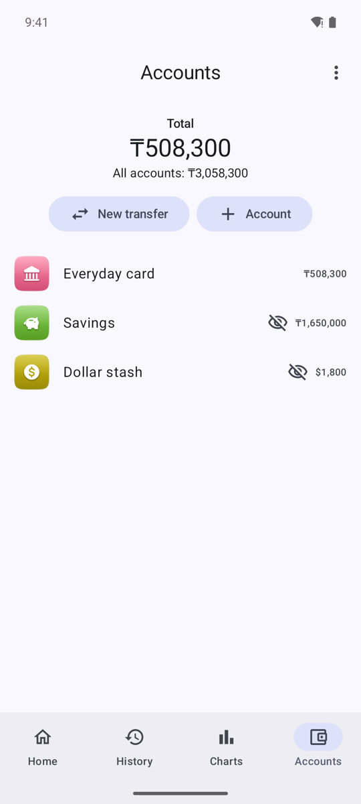
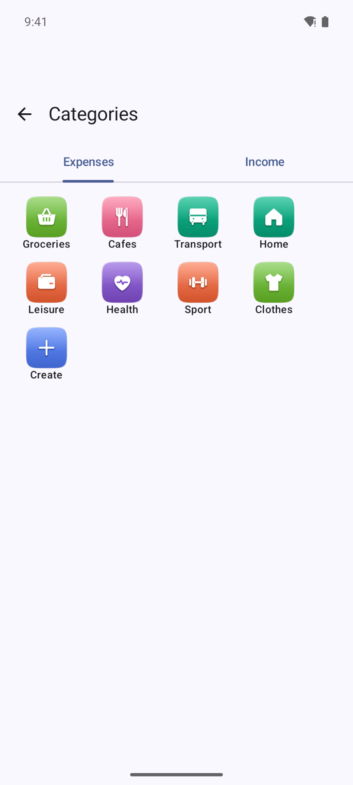

# Accounts, categories, tags

 

## Accounts
- *Accounts* shows each balance, a **Total** and below it **All accounts**.
- *+ Account*: name, currency, icon, color.
- **Hide from the Total**: the account gets an eye-off icon and is left out of the headline Total (it still counts in All accounts). Useful for savings or foreign-currency stashes.
- **Archive account**: keeps history but removes it from the pickers.
- **New transfer** moves money between accounts.

## Categories
- *More → Categories*, tabs **Expenses** and **Income**. Tap a tile to edit, **Create** to add.
- Each category has a name, icon and color.
- **Planned outlay per month** (the limit): drives the forecast bars and warnings.
- **Warn at % of the limit**: per-category threshold; empty uses the global one (*More → Spending warnings*).
- **In the overall projection**: Automatic / Always / Never. Automatic leaves out one-off categories (fewer than 2 operations a month over the last 3 full months).

## Tags
*More → Tags* lists tags with their use counts. Add tags to an entry on the Add screen; typing an unknown name creates it.
