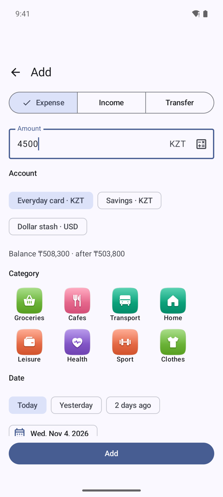
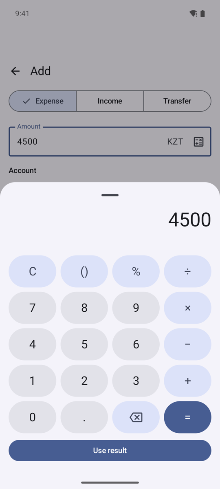

# Entering data

 

Tap **+** (bottom right of Home and History).

## Expense or income
1. Choose **Expense** or **Income** at the top.
2. Type the amount. The currency follows the chosen account. Under the account row you see the balance and what it will be after saving.
3. Pick the **account**, then the **category** (the selected tile gets an outline).
4. Pick the **date**: Today, Yesterday, 2 days ago, or the calendar.
5. Optionally add tags and a comment.
6. Tap **Add** (pinned above the keyboard).

## Calculator
The calculator icon in the amount field opens a keypad: `C`, smart parentheses, `%`, `÷ × − +`, decimals, backspace, `=` and a live preview. Percent works like the phone's calculator: `1000 + 10%` = 1100, `200 × 10%` = 20. **Use result** puts it in the field. Results round to cents.

## Transfer
Choose **Transfer**, pick From and To accounts, amount, date and comment. Between accounts in different currencies the two amounts can differ.

## Edit or delete
Open **History**, tap an entry, change it and save, or use the trash icon at the top to delete (with confirmation).

## Overwrite a balance
*Accounts →* the account *→ Overwrite balance*: type the **real balance now** and tap the button. The app adds an Income or Expense for the difference, dated today, with **no category**. In History, Home and Charts it appears as "Balance correction".
