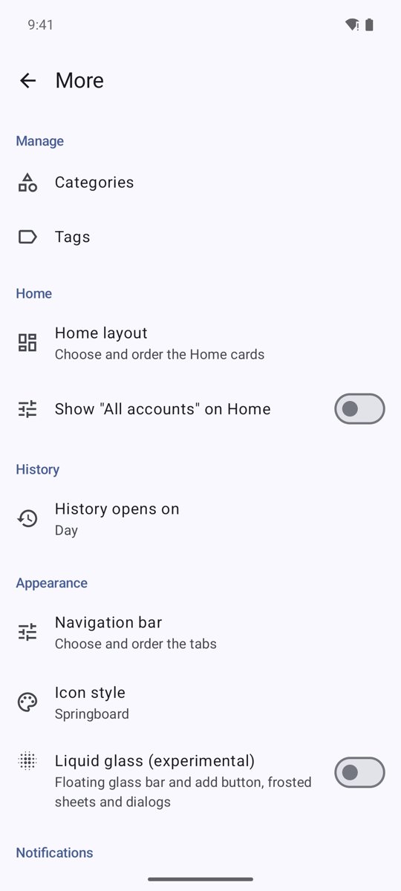

# Getting started

## Install
1. Download `money-tracker-vX.Y.Z.apk` from the repository's GitHub release page.
2. Open it on the phone and allow installing from that source when Android asks.
3. The app needs **Android 16 (API 36)**.

Later versions: *More → App updates → Check for updates*. The app asks GitHub for the latest release, shows what is new, downloads in the background (it resumes if interrupted) and installs. Android asks you to confirm.

## First launch
The app starts empty: Home, History, Charts and Accounts in the bottom bar (the bar is configurable, see [Settings](Settings.md)).
Create your accounts (*Accounts → + Account*) and categories (*More → Categories*), or import a backup.

## Import a `.mmbackup` backup
1. Copy the `.mmbackup` file to the phone's **Downloads** folder.
2. *More → Data and sync → Import .mmbackup* and pick the file.
3. The app reports how many transactions, transfers, accounts and categories it imported.

Rules: only live rows are imported; the import **adds** rows the phone does not have and replaces a row only when the backup's copy is newer, so it never undoes later phone edits. The file is read, never written.

## Allow notifications
Android asks for notification permission the first time you switch on the daily reminder or spending warnings. Without it, neither can show.
