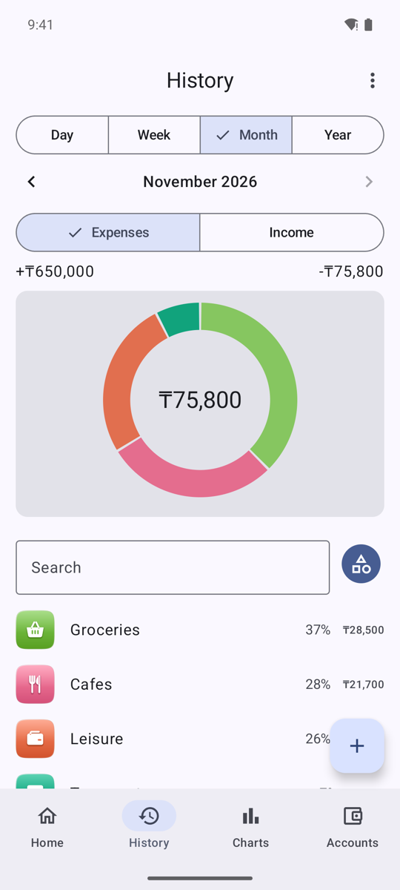
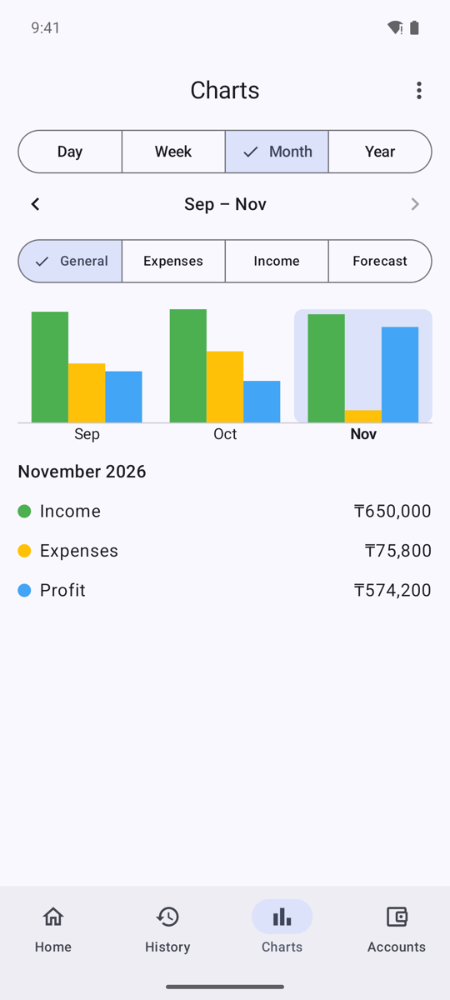
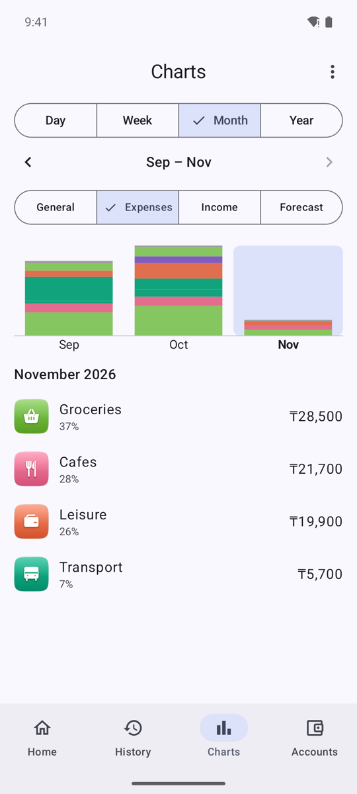
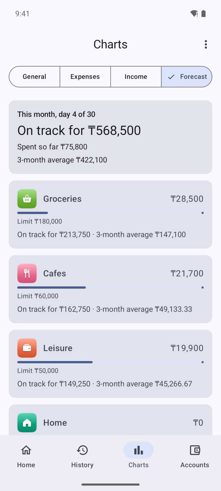

# History, charts, forecast

## History

- Slicer **Day / Week / Month / Year**, arrows to move one period; the next arrow stops at the present; tap the title to jump back to today.
- Switch **Expenses / Income** to choose the side shown; the donut and totals follow.
- Entries are grouped by category with share and amount; the toggle beside Search turns grouping off. Tap a group to expand its entries; tap an entry to edit.
- *More → History opens on* sets the default period (Day by default).

## Charts
 

- Same Day / Week / Month / Year slicer and period arrows as History. By month shows 3 bars, by day 7, by week 4, by year 3.
- **General**: income, expenses and profit/loss bars. **Expenses** and **Income**: stacked by category.
- Tap a bar for its totals and category shares.

## Forecast

- **On track for** = spent so far ÷ days elapsed × days in the month (run-rate), overall and per category.
- **3-month average** is shown next to it as a reference; the two are never mixed.
- Each category with a limit has a bar against it. Categories at risk come first.
- Early in the month the run-rate is noisy ("day 4 of 30" above), so "on track" warnings wait until day 10; "over the limit" and 3-month-average warnings do not.

## Warnings
A card on Home and a notification (channel *Spending warnings*), at most one per month, category and level, escalating: 3-month average over the limit → on track to exceed → over the limit. Threshold and the notification switch: *More → Spending warnings*.
