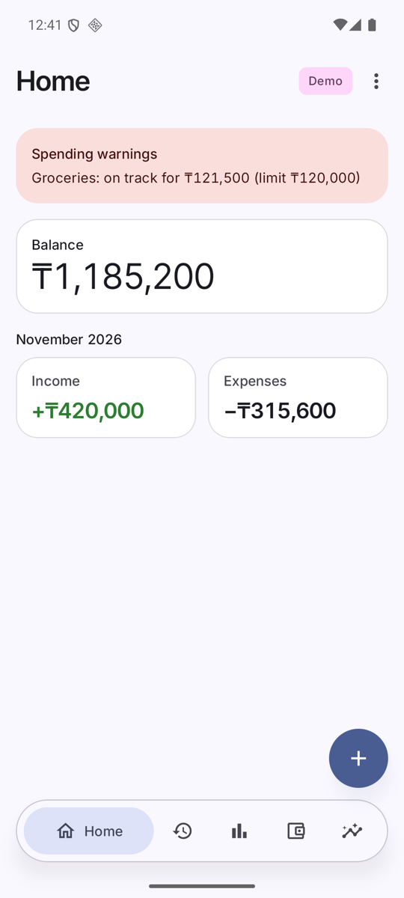

# Money Tracker wiki

Personal Android expense tracker: quick entry, charts, forecasts with limit warnings, Google Sheets copy. No ads, no payments.

| Page | What is in it |
|---|---|
| [Getting started](Getting-Started.md) | Install, first launch, importing a backup |
| [Entering data](Entering-Data.md) | Expenses, income, transfers, calculator, editing, balance overwrite |
| [Accounts, categories, tags](Accounts-Categories-Tags.md) | Setting up your structure and monthly limits |
| [History, charts, forecast](History-Charts-Forecast.md) | Reading your spending and the warnings |
| [Wealth and compound interest](Wealth-and-Compound-Interest.md) | Net worth, goals, bonds, monthly money, calculator |
| [Widgets](Widgets.md) | Home-screen widgets |
| [Privacy and backup](Privacy-and-Backup.md) | App lock, file backup and restore |
| [Google Sheets sync](Google-Sheets-Sync.md) | Use your data on a computer |
| [Settings (More)](Settings.md) | Home layout, navigation bar, icon style, reminders |
| [FAQ](FAQ.md) | Common questions and limits |

Screenshots use fictional demo data generated by `tools/make_demo_backup.py`.
