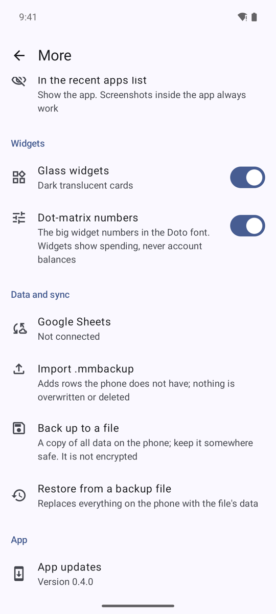

# Privacy and backup

## App lock (More → Privacy)

- **App lock**: set a 4–6 digit PIN. After wrong tries the app makes you wait (30 s, 1 min, 5 min, ...). The PIN is stored only as a salted hash.
- **Unlock with fingerprint or face**: shown only when the phone has an enrolled strong biometric. The PIN always works as a fallback.
- **Lock after**: how long the app may be out of sight before it asks again.
- **In the recent apps list**: show the app normally, blur it, or hide it. Screenshots inside the app always work.
- There is no server, so a **forgotten PIN cannot be reset**. The way out is to clear the app's data and restore a backup file (or sync from the sheet), so keep one.

## Back up to a file (More → Data and sync)
1. Tap **Back up to a file**.
2. Choose where to save it in the system file picker (Downloads, Drive, a USB drive). The file is named `moneytracker-YYYY-MM-DD.db`.
3. Keep it somewhere safe: **it is not encrypted**, and it holds all your data, including the wealth tables, which the Google Sheet does not.

## Restore from a backup file
1. Tap **Restore from a backup file** and pick a file.
2. The app checks it and shows what is inside. Confirm with **Restore**.
3. **Everything on the phone is replaced** by the file's data.

## Before an update
When you install an update from inside the app, it first saves an automatic copy of your data. If Android refuses the update, the message points you to that copy instead of telling you to reinstall from scratch.

## Back up often enough
The Google Sheet is a second copy of ledger data only. A weekly folder backup and a "last backup is old" reminder are planned but not built, so make a file backup after big changes.
