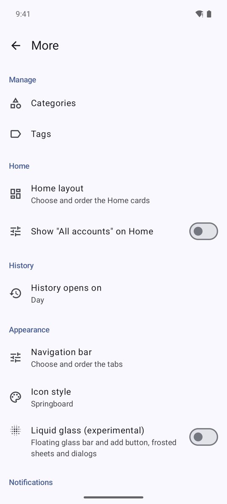
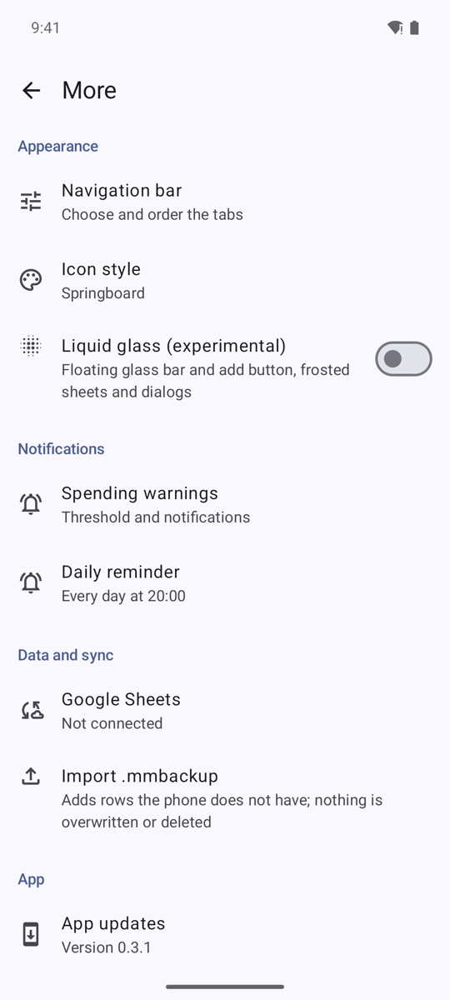

# Settings (the More screen)

 

| Section | Setting | What it does |
|---|---|---|
| Manage | Categories, Tags | Edit the lists |
| Home | Home layout | Choose and order Home cards (warnings, balance, income and expenses, top spending, latest entries); totals can cover a day, week, month or year |
| Home | Show "All accounts" on Home | Extra figure under the balance (off by default) |
| History | History opens on | Day, Week, Month or Year |
| Appearance | Navigation bar | 2 to 5 tabs from Home, History, Charts, Accounts, Categories, Tags; reorder with arrows; the first tab opens with the app |
| Appearance | Icon style | Three looks for category and account icons |
| Appearance | Liquid glass (experimental) | Floating glass bar and button, frosted sheets; needs Android 13+, off by default |
| Notifications | Spending warnings | Warn at % of a limit, notifications on/off |
| Notifications | Daily reminder | Switch and time (default 20:00) |
| Data and sync | Google Sheets | See [Google Sheets sync](Google-Sheets-Sync.md) |
| Data and sync | Import .mmbackup | Add rows from a `.mmbackup` file |
| App | App updates | Check, download and install the latest release |

Swipe left or right on a tab screen to move to the neighbouring tab. Colors follow the system accent and dark mode.
