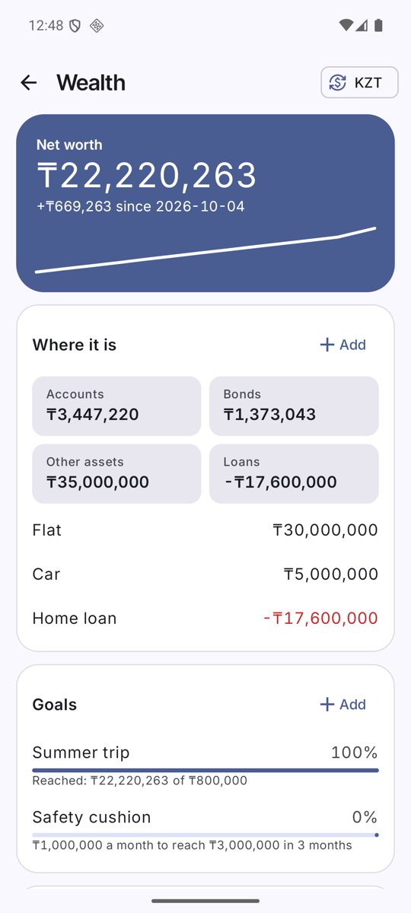
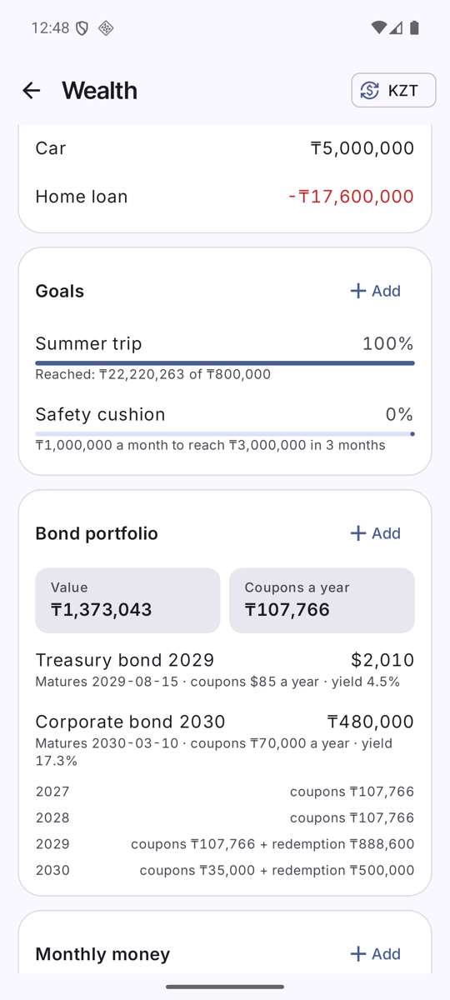
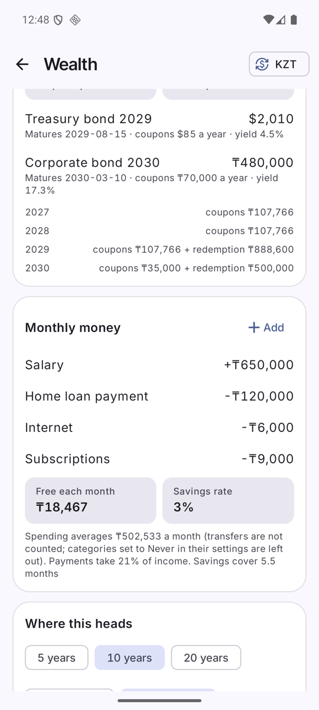
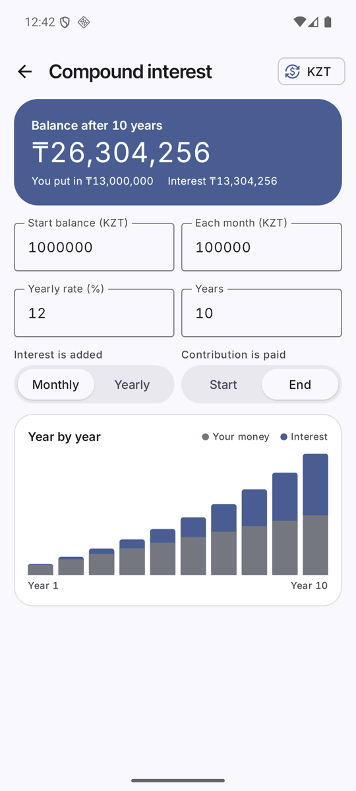

# Wealth and compound interest

Open **More → Wealth** or **More → Compound interest**. You can also add *Wealth* to the bottom bar (*More → Navigation bar*).

  

Wealth data (assets, loans, goals, bonds, monthly money, net-worth history) is stored **on the phone only**. It is not in the Google Sheet. *More → Back up to a file* copies it. See [Privacy and backup](Privacy-and-Backup.md).

## Net worth
- The big card is your net worth: every account (also those hidden from the Total) + bonds at current value + manual assets − loans, with the change since the last snapshot and a history line. A snapshot is taken once a day.
- A snapshot is skipped while a currency has no rate, so a missing rate never looks like a loss.
- **Where it is → Add**: manual assets (a flat, a car) and loans, each with a currency and a value you update by hand.
- Tip: if a broker account is both an app account and listed as bonds, it counts twice. Use one of the two.

## Currency
The currency button (top right) switches the whole screen between KZT, USD, EUR, RUB and others. Rates come from the National Bank of Kazakhstan, fetched **once a day** and cached, so it also works offline. Stored amounts stay in KZT or in their own currency; only the display changes. The choice is remembered.

## Goals
**Goals → Add**: a title, a target amount and a date, optionally tied to one account. The bar shows progress, and the line below says how much to put aside each month to arrive on time (for example "₸450,000 a month to reach ₸3,000,000 in 3 months").

## Bond portfolio
**Bond portfolio → Add**: title, currency, face value, number of pieces, total price paid, coupon rate, coupons per year, maturity date and (optionally) the current value. You see value, coupons per year, current yield, an estimated yield to maturity, and a year-by-year ladder of coupons and redemptions. Prices are typed in by hand (no live quotes). Yield to maturity ignores accrued interest, tax and fees: treat it as an estimate.

## Monthly money
**Monthly money → Add**: your income and regular payments (mortgage, loans, subscriptions). Tick "already in my expenses" for a payment you record in the ledger, so it is not counted twice. You get:
- **Free each month** and **Savings rate**.
- Average spending (last 3 full months; transfers and balance corrections are not counted), payments as a share of income, and how many months your savings cover.
- **Where this heads**: net worth in 5, 10 or 20 years, with 0%, 50% or 100% of the free money invested.

## Compound interest calculator

Enter a start balance, an amount each month, a yearly rate and a number of years. Choose whether interest is added **monthly** or **yearly**, and whether the contribution is paid at the **start** or **end** of the month. The result card shows the final balance, how much you put in and how much is interest; the chart shows each year.
